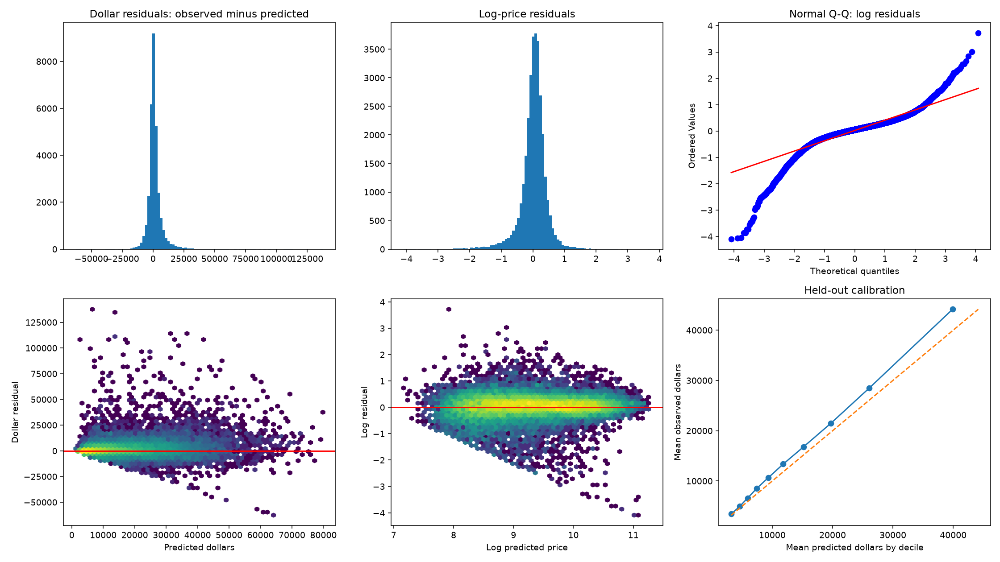
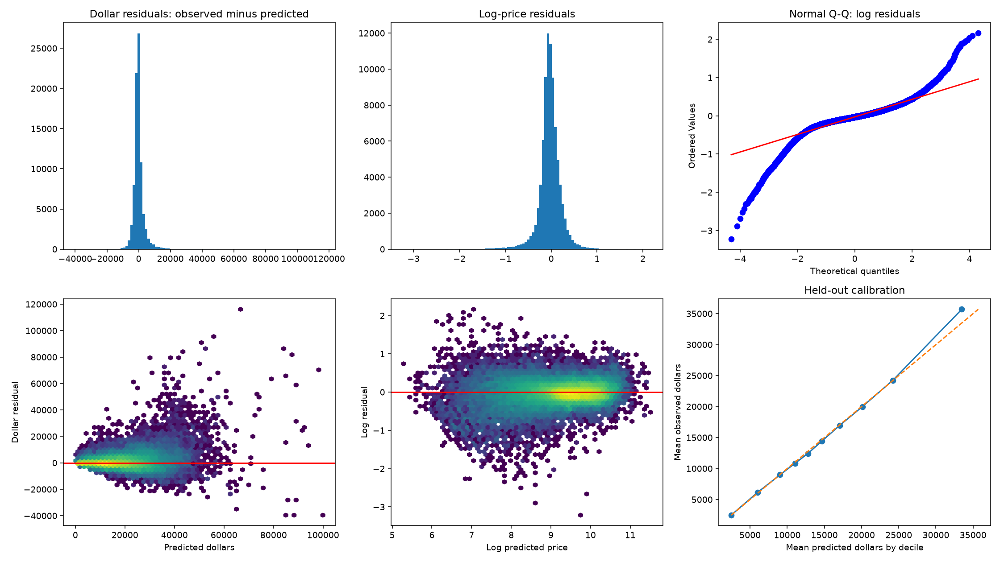

# CatBoost AFT assessment and residual analysis

Native categorical, tabular-only model; original chronological partitions. No filtering or deployment in this experiment. Up to 1,000 trees; best iteration ask 999, auction 997. Validation selects stopping; test is not fitted.

| Market | Test cars | MAE | RMSE | Mean observed minus predicted | Log RMSE | Spearman |
|---|---:|---:|---:|---:|---:|---:|
| ask | 31,682 | $3,745.58 | $7,392.38 | $1,530.85 | 0.4170 | 0.9058 |
| bid | 83,603 | $2,182.16 | $4,082.28 | $136.46 | 0.2446 | 0.9598 |

Asking dollar errors grow with fitted price (Spearman 0.474); log residuals are heavy-tailed (excess kurtosis 9.19), with systematic underestimation across all predicted-price deciles. Validation smearing reduces test mean underestimation from $1,531 to $142, and MAE from $3,746 to $3,691. This is a calibration alternative, not a new selected winner.

Both models reached approximately the 1,000-round budget; this is not proof of convergence or global optimality. The tabular comparison excludes the existing transformer branch.

The CatBoost weights and compact reports are preserved together in [assessment bundle](https://chatgpt.com/library?file_id=libfile_b4a9fc8f2da48191aa979d6815f9475f&account_id=personal). Full residual tables are reproducible by the committed script. See [methodology](../../CATBOOST_AFT.md).

